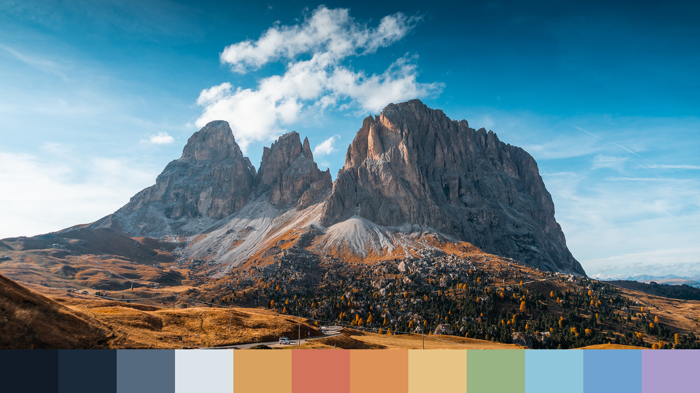

# Highland

An [Omarchy](https://omarchy.org) theme drawn from alpine landscapes: a deep
night-sky navy base, cloud-white text, and a golden-meadow accent, with glacier,
rust and pine tones filling out the palette.



## Install

```bash
omarchy theme install https://github.com/phoscoder/highland-omarchy-theme.git
omarchy theme set highland
```

## Palette

| Role       | Hex       | Source                       |
|------------|-----------|------------------------------|
| Background | `#101b27` | night sky above the summit   |
| Foreground | `#dce4ea` | cumulus clouds               |
| Accent     | `#d9a25f` | autumn meadow grass          |
| Red        | `#d4735c` | rust-red meadow              |
| Orange     | `#dd9257` | ochre slopes                 |
| Yellow     | `#e6c486` | sunlit straw                 |
| Green      | `#98b384` | pine forest                  |
| Cyan       | `#8fc6db` | glacier ice                  |
| Blue       | `#6fa3d1` | open sky                     |
| Magenta    | `#ab9dcb` | dusk haze                    |

Every accent clears 5:1 contrast against the background; body text is 13.5:1.

The active window border is a gold-to-glacier gradient. Everything else
(terminals, btop, Neovim, VS Code, Chromium, the Omarchy shell) is generated
by Omarchy from `colors.toml`.

## Wallpapers

Cycle with `omarchy theme bg next`.

1. `1-dolomites.jpg`: Sassolungo, Dolomites ([wallhaven mlokky](https://wallhaven.cc/w/mlokky))
2. `2-summit.png`: digital art ([wallhaven gw1e23](https://wallhaven.cc/w/gw1e23))
3. `3-cumulus.jpg`: Jonathan Curry ([wallhaven zpvdzv](https://wallhaven.cc/w/zpvdzv))
4. `4-meadow.jpg`: Yosemite Valley, Cloris Ying on Unsplash ([wallhaven og7m65](https://wallhaven.cc/w/og7m65))

All images belong to their respective authors.
